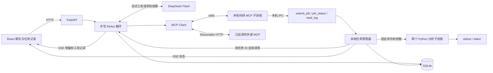

# 科研计算任务助手

在本机用自然语言提交 FASTA 分析，查看任务状态，再根据实际输出和错误日志解释结果。界面保留每次工具的名称、入参与返回值。会话、上传文件和计算结果在关闭页面或重启后端后仍可查阅。

## 启动

项目需要 Python 3.12 和满足 Vite 要求的 Node.js。当前开发环境使用 Python 3.12.14 和 Node.js 24.15.0。使用独立电脑复现时，可安装 Python 3.12 和 Node.js 22.12 或更新的 LTS。以下命令均在仓库根目录执行。

### Windows PowerShell

```powershell
py -3.12 -m venv .venv
.\.venv\Scripts\python.exe -m pip install -r requirements.txt
npm --prefix frontend ci
npm --prefix frontend run build
if (-not (Test-Path .env)) { Copy-Item .env.example .env }
```

已有虚拟环境时可跳过创建步骤。Windows 的 Python 安装若没有 `py` 命令，可以用已安装的 `python -m venv .venv`。也可用 `uv pip install --python .venv/Scripts/python.exe -r requirements.txt` 安装 Python 依赖。

打开项目根目录的 `.env`，在 `DEEPSEEK_API_KEY=` 的等号后填入自己在 DeepSeek 平台创建的 Key。`DEEPSEEK_MODEL` 和 `DEEPSEEK_BASE_URL` 已有默认值。保留 `deepseek-flash` 和 `https://api.deepseek.com` 即可。模型请求通过 HTTP 流式接口发送。[DeepSeek 首次调用与 Key 入口](https://api-docs.deepseek.com/zh-cn/) · [工具调用协议](https://api-docs.deepseek.com/guides/tool_calls/)

```powershell
.\.venv\Scripts\python.exe -m uvicorn backend.app.api:app --host 127.0.0.1 --port 8767 --timeout-graceful-shutdown 3
```

在浏览器打开 [本机工作区](http://127.0.0.1:8767)，点击“创建账号”注册并登录。密码至少 7 位。修改 `.env` 后重启服务。Key 留空时可以登录和管理文件，聊天区会提示如何配置。在启用 API 后，聊天文本和限长的工具结果会发给 DeepSeek，FASTA 文件由本机脚本读取。

### macOS 或 Linux

```bash
python3.12 -m venv .venv
.venv/bin/python -m pip install -r requirements.txt
npm --prefix frontend ci
npm --prefix frontend run build
test -f .env || cp .env.example .env
```

按同样方式填写 `.env`，再运行 `.venv/bin/python -m uvicorn backend.app.api:app --host 127.0.0.1 --port 8767 --timeout-graceful-shutdown 3`。开发界面时可另开终端执行 `npm --prefix frontend run dev`，在 `http://127.0.0.1:5173` 打开 Vite 页面，API 仍走 8767。

## 账号和工作区

- **首页**保留历史会话、流式聊天、工具记录和当前会话任务。
- **文件管理**支持上传、下载和将文件带入聊天分析。每个账号有自己的上传文件，同一账号可跨会话复用。三个内置题面样例供各账号使用。
- **任务管理**按账号展示全部任务。可按状态筛选，按文件名或完整 ID 搜索。详情显示执行时间、退出码、标准输出和错误日志。长日志可以逐段阅读，任务结束后可下载完整文件。
- **工具管理**提供 MCP 服务、工具列表和 Skills。新账号在「MCP 服务」中点击「添加本机 MCP」，完成工具发现后即可发起分析。升级前已存在的账号继续使用科研工具。

账号密码以带随机盐的 scrypt 哈希保存，浏览器使用会过期的 HttpOnly 会话 Cookie。SQLite 根据会话所属账号筛选文件、对话、任务和日志，实时事件也按账号推送。[OWASP 密码存储](https://cheatsheetseries.owasp.org/cheatsheets/Password_Storage_Cheat_Sheet.html) · [OWASP 会话管理](https://cheatsheetseries.owasp.org/cheatsheets/Session_Management_Cheat_Sheet.html)

### MCP 服务和 Skills

- **本机科研任务服务。** FastAPI 使用当前 Python 解释器运行 `python -m backend.app.research_mcp`，由官方 MCP SDK 管理 stdio 子进程。前端点击添加时调用 `tools/list`，为当前账号保存启用状态。三个科研工具是任务流程的必需工具。
- **外部 MCP。** 在 `.env` 的 `MCP_HTTP_ENDPOINTS` 中用逗号分隔可供各账号选择的可信 Streamable HTTP 地址，重启后端后在工具管理连接。默认地址是公开的 AWS Knowledge。成功接入后显示发现的工具，按账号启用 Server 和具体工具。刷新保留单工具开关，已从上游移除的工具标为不可用。[AWS Knowledge 接入文档](https://awslabs.github.io/mcp/servers/aws-knowledge-mcp-server#configuration)
- **文字型 Skill。** 在 Skills 页添加名称、触发短语和说明。可填入「科研结果报告」示例。启用后，请求中出现触发短语时加载这份说明，用来组织结果。工具权限仍由后端控制。

导航图标使用 Lucide，任务详情参考了科研作业管理中同时呈现状态、退出码和原始日志的设计。[Lucide 图标](https://lucide.dev/icons) · [Seqera 运行详情](https://docs.seqera.io/platform-cloud/getting-started/quickstart-demo/view-run-information)

如果从旧的单用户版本升级，已有记录保留在原数据库中。确认整套旧记录归属同一个账号后，可在先注册该账号并备份 `var/` 的前提下，用本机命令将记录关联到它。旧文件重名时自动加数字后缀，任务记录保留提交时使用的文件名。

```powershell
.\.venv\Scripts\python.exe -m backend.app.assign_legacy -- 你的用户名
```

### 跨会话分析偏好

结果展示顺序和 GC 百分比小数位数按账号保存在 SQLite 中。可以在聊天里说「以后统计 GC 时保留一位小数」或「记住，以后按序列 ID 升序展示结果」，后端会保存对应设置。同一账号开启新会话时，助手会在相关分析或结果查询中加载需要的偏好。比如 ORF 结果只会加载排序偏好。「这次保留两位小数」只影响当前轮次和当轮提交的任务。

在会话侧栏底部的「分析偏好」可查看和修改已保存的设置。将某项改回「使用默认规则」即可清除对应偏好。

序列统计在原始输出保留 G/C 碱基数 `gc_count` 和确定碱基数 `known_bases`。后端先读取当前请求指定的 0–2 位小数，再回退到账号偏好和默认的两位，使用这两个计数一次舍入。聊天工具卡会显示换算结果和计数。仅保存了两位小数的早期日志使用当时的数值。

## 演示路径

1. 在新会话发送“帮我统计一下 sample1 里序列的 GC 含量”。提交后右侧出现任务。完成时自动出现状态、日志调用和解释。展开 `read_log` 可以核对 `seq1` 的 **45 nt、48.89%** 和 `seq2` 的 **47 nt、61.70%**。
2. 在原会话继续说“再对 sample3 做一次”。助手沿用序列统计，并主动读新任务的错误日志。「待补充文件」高亮第 1 行缺少的 `>` 和第 2 行第 7–9、16–18 列的非法字符。核对原始数据后，可上传修正版并确认继续。
3. 发送“找出 sample2 中每条序列最长的 ORF”。`gene_A` 的结果为 **6–83，共 78 nt**，`gene_B` 为 **7–21，共 15 nt**。任务运行时可切换会话，完成后原会话收到提示。
4. 使用“上传 FASTA”添加自己的 `.fa`、`.fasta` 或 `.fna`，再发送一条分析请求。每个文件最大 5 MiB。上传成功显示登记名，分析阶段校验内容。刷新页面后可重新打开上次的会话并展开工具记录。

一份 3–5 分钟的录屏脚本和面谈要点在交付计划中。[三天排期与交付计划](docs/04-三天排期与交付计划.md)

## 架构和实现



- `backend/app/model.py` 解析 DeepSeek 流式正文、按索引拼齐工具参数。`backend/app/agent.py` 通过 MCP Client 获取工具结果，并回填对应的 `tool_call_id`。每阶段最多调用模型 6 轮。DeepSeek 的模型思考模式使用关闭配置，调用工具和消费结果的 ReAct 循环由应用实现。
- `backend/app/research_mcp.py` 定义并注册 `submit_job`、`job_status`、`read_log`。`backend/app/mcp_tools.py` 的 Client 通过 `tools/list` 获取定义，并通过 `tools/call` 调用工具。Server 子进程使用标准输入和输出通信，内部转发使用本机命名管道或 Unix 域套接字。FastAPI 继续管理账号权限、SQLite、任务队列和通知。前端和 API 使用原来的 `8767`，本机 MCP 子进程无需监听 TCP 端口。[MCP stdio 规范](https://modelcontextprotocol.io/specification/2026-07-28/basic/transports/stdio) · [MCP Python SDK](https://github.com/modelcontextprotocol/python-sdk)
- `backend/app/external_mcp.py` 负责外部 Server 连接和工具发现。后端按账号与两个启用开关筛选候选工具，执行前再次校验启用状态和工具自己的 JSON Schema。同名工具用各自的 Server 和工具标识定位。
- `backend/app/jobs.py` 本地最多同时执行两个任务。每个脚本内部延时 4 秒，提交立即返回，单任务上限默认 60 秒。任务的退出码和输出由后端记录。任务结束时，助手查询同一个 ID，再读日志生成解释。
- `backend/app/store.py` 管理 SQLite 中的账号与会话凭证、对话、工具记录、文件登记和任务。相同客户端消息的重发使用同一消息 ID，重复工具提交复用同一任务。重启时继续处理已排队的任务和计划重试，执行中的任务记为中断，待解释的终态可从原日志恢复。
- `scripts/` 放两个可单独运行的脚本。统计以 A、C、G、T 为 GC 分母，IUPAC 歧义碱基计入总长度。ORF 取正链三个阅读框中最长的完整 `ATG` 到同框终止区间，坐标从 1 开始、含两端，等长取较早起点。`sample3` 的两处错误由同一个共享解析器收集。
- `frontend/` 通过一个 SSE 连接接收消息增量、工具轨迹和任务通知。断线后从 SQLite 快照恢复。`var/` 保存 SQLite、上传文件和两路原始日志，工具预览每路最多约 8 KiB。任务记录可下载完整日志。模型调用失败时，系统仍能读取本机日志，并提供“重新解释”。

已实现的加分项包括 MCP 封装、主动完成通知、上传 FASTA 和关键用例测试。外部 MCP 的发现、分开启停以及按需加载 Skill 的方式参考了 Data Agent 的扩展管理实现。Docker Compose 留作后续选项。对照项目、计算基准和验收条件见评审文档。[技术方案](docs/02-技术调研与开发方案.md) · [样例基准与验收用例](docs/03-样例基准与验收用例.md)

## 失败任务与重跑

- 聊天和任务管理使用后端计算的排队等待时长与执行时长。脚本在后台执行时可以继续聊天，任务结束后助手会主动在原会话报告结果。
- 打开任务管理里的失败任务可查看分类、失败阶段和原始日志。选择「重新运行」会创建关联的新任务，同一失败记录的重复提交会返回同一个后续任务。通过「尝试记录」可以切换查看各次运行。
- 进程启动明确因资源暂不可用时，后端默认最多自动重试两次，分别延迟 3 秒和 6 秒。超时、持续资源不足和配置错误会保留失败信息，处理原因后可以手动重跑。
- 文件缺失或输入校验失败时，在原会话的「待补充文件」卡片选择或上传文件，再确认继续。格式错误显示日志定位到的行列和本机原文片段。只有补齐首条标题后能通过完整校验的文件才提供格式修复预览。确认后系统保存副本并关联新任务，原文件和失败日志保留。

## 长会话上下文

每次请求 DeepSeek 前，`context.py` 按完整轮次装入近期对话。预算包括系统指令、当前问题、工具定义和本轮工具结果。预算紧张时减少较早轮次并缩短日志预览，工具调用与结果仍按 ID 配对。可在 `.env` 配置 `DEEPSEEK_INPUT_TOKEN_BUDGET`，默认 24,000。程序以序列化后的 UTF-8 大小加协议余量作保守估算，实际用量以 DeepSeek API 返回为准。[DeepSeek Token 用量说明](https://api-docs.deepseek.com/quick_start/token_usage/)

当至少 4 个尚未概括的旧轮次滑出窗口时，助手分批更新 SQLite 中的滚动摘要。摘要保存覆盖到的消息 ID，重启后继续使用。摘要生成失败时，本轮仍可用当前上下文回答。用户在同一会话按任务 ID 或文件名追问时，后端从 SQLite 取回任务记录，再由 Agent 调用状态或日志工具。完整聊天记录、工具轨迹和任务日志可在工作区回看。

## 测试

```powershell
.\.venv\Scripts\python.exe -X utf8 -m unittest discover -s tests -v
npm --prefix frontend run build
```

测试使用可控的模型流式响应，实际运行本机分析子进程和 SQLite。覆盖样例结果、异步运行、会话恢复、跨账号访问、完整日志读取、逐次调用预算、摘要续写以及旧任务回查。真实模型联调使用上面的演示路径，需要自己的 Key。

## 打包

本地 Git 提交记录保留开发过程。准备评审材料时使用一个独立的 Git 仓库链接，或用 Git bundle 保存全部提交历史。

```powershell
git bundle create research-task-assistant.bundle --all
```

接收方可用 `git clone research-task-assistant.bundle research-task-assistant` 恢复源码和历史。`.env`、`var/` 和 Office 源题均由 `.gitignore` 排除。提交给研究院时，附上使用真实模型录制的 3–5 分钟演示，包含 `sample3` 的失败诊断。
