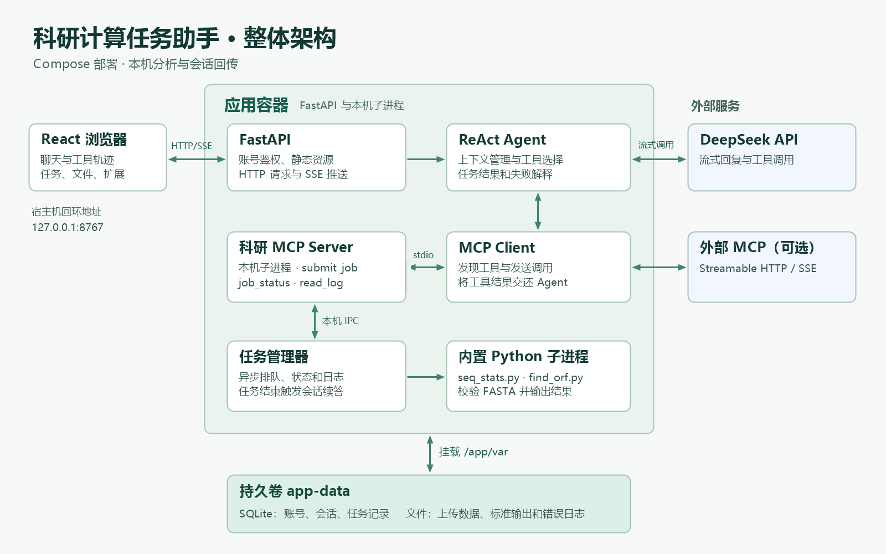

# 科研计算任务助手

研究员用中文对话提交 FASTA 分析，助手自己调用工具、在本机启动脚本、读取日志并用普通人能看懂的话解释结果。界面保留每次工具调用的名称、入参和返回值，会话、上传文件和任务记录在刷新页面或重启后端后仍然存在。

## 功能对照

**必做项**

| 题目要求 | 当前实现 |
| --- | --- |
| 聊天界面、回复流式显示 | React 单页，SSE 逐字推送正文和工具记录 |
| 工具调用可见（名称、参数、返回） | 每条工具调用一张可折叠卡片，参数与结果都在卡片里 |
| 左侧历史会话，可新建/切换 | 会话列表按账号返回，切换和刷新后从 SQLite 恢复 |
| 自己实现 ReAct 循环 | `backend/app/agent.py` 手写“模型思考 → 调工具 → 拿结果 → 继续”循环，未使用低代码平台 |
| 三个工具 | `submit_job`、`job_status`、`read_log`，经本机 MCP Server 暴露 |
| 任务异步执行，不阻塞对话 | 后台独立子进程 + 队列，提交后立即返回任务 ID |
| `seq_stats` / `find_orf` 两个脚本 | `scripts/seq_stats.py`、`scripts/find_orf.py`，各带 4 秒模拟耗时 |
| 失败时主动读日志并解释 | 失败任务由助手自动 `read_log` 后解释，附可定位到行列的诊断 |
| 会话与消息入库 | SQLite（`var/assistant.sqlite3`），重启后继续排队任务和处理 |

**加分项**

| 加分项 | 状态 |
| --- | --- |
| 用 MCP 协议封装三个工具 | 已做：本机 stdio MCP Server，后端是 MCP Client；另外支持登记外部 MCP 服务 |
| 任务完成后主动通知前端 | 已做：任务终态通过 SSE 推送，并在原会话自动续答 |
| 界面上传自己的 FASTA | 已做：每个账号独立文件区，单文件上限 5 MiB |
| 关键逻辑有单元测试 | 已做：66 个用例，见[测试](#测试) |
| Docker Compose 一键启动 | 已做：`docker compose up --build` |

## 快速开始

### 环境要求

- **方式一（推荐）**：Docker Desktop（Windows/macOS）或 Docker Engine + Compose v2。
- **方式二**：Python 3.12、Node.js `^20.19.0 || >=22.12.0`（Vite 7 的要求）。
- 一个 DeepSeek API Key（[申请入口](https://platform.deepseek.com/)）。没有 Key 也能登录、管理文件、看样例，聊天区会提示去配置。

### 方式一：Docker Compose 一键启动

```bash
cp .env.example .env          # Windows PowerShell: Copy-Item .env.example .env
# 编辑 .env，在 DEEPSEEK_API_KEY= 后面填入自己的 Key
docker compose up --build
```

首次构建会拉取 `node:22-alpine` 和 `python:3.12-slim` 并安装依赖，之后启动很快。浏览器打开 <http://localhost:8767>，注册账号（密码至少 7 位）即可开始。

- 数据保存在命名卷里（默认名 `<目录名>_app-data`），`docker compose down` 不删数据，`docker compose down -v` 清空重来。
- 端口被占用时用 `APP_PORT=9000 docker compose up --build`，然后访问 <http://localhost:9000>。
- Ubuntu 服务器上的服务同样绑定回环地址。在自己的电脑上执行 `ssh -N -L 8767:127.0.0.1:8767 ubuntu@你的服务器`，再打开 <http://localhost:8767>。
- Compose 直接从同目录的 `.env` 读取变量注入容器，镜像里不包含 `.env`，Key 不会被打进镜像。

如果服务器拉取 Docker Hub 镜像超时，可在 `.env` 中指定 Docker 在 ECR Public 发布的镜像，再执行同一条启动命令。[Node 镜像](https://gallery.ecr.aws/docker/library/node) · [Python 镜像](https://gallery.ecr.aws/docker/library/python)

```dotenv
NODE_BASE_IMAGE=public.ecr.aws/docker/library/node:22-alpine
PYTHON_BASE_IMAGE=public.ecr.aws/docker/library/python:3.12-slim
```

若 Python 依赖下载较慢，可在 `.env` 中将 `PYTHON_PACKAGE_INDEX` 设为可访问的索引。这台 Ubuntu 服务器实测使用了 `https://mirrors.cloud.tencent.com/pypi/simple`。[腾讯云软件源说明](https://cloud.tencent.com/document/product/213/8623)

### Ubuntu 实机验证

在 Ubuntu 24.04.4（Docker Engine 29.1.3、Compose 2.40.3）上执行 `docker compose up -d --build --wait`。前端构建使用服务器已缓存的 `NODE_BASE_IMAGE=node:24-alpine`，Python 运行镜像使用上面的 ECR Public 镜像，依赖索引使用腾讯云源；构建出的应用镜像约 58.7 MB。

- 容器达到 `healthy`；首页和前端 JS/CSS 返回 HTTP 200，未登录的 `/api/config` 返回 401。
- 注册账号返回 201；`/api/tools` 列出 `submit_job`、`job_status`、`read_log` 三个 MCP 工具；上传 FASTA 返回 201 并出现在文件列表。
- 在容器内直接运行内置脚本：`sample1` 的 `seq1` 为 45 nt / 48.89%、`seq2` 为 47 nt / 61.70%；`sample2` 的 `gene_A` 为 6–83（78 nt）、`gene_B` 为 7–21（15 nt）；`sample3` 退出码 2，错误日志同时给出缺标题行和非法字符两处诊断。
- `docker compose up -d --force-recreate --wait` 重建容器后，原登录会话、账号和上传文件仍可读取（数据在命名卷 `app-data`）。
- 镜像内没有 `.env`；这轮使用空 Key 验证部署，容器环境变量里没有真实 Key。

### 方式二：本机运行（Python + Node）

以下命令都在仓库根目录执行。

**Windows PowerShell**

```powershell
py -3.12 -m venv .venv
.\.venv\Scripts\python.exe -m pip install -r requirements.txt
npm --prefix frontend ci
npm --prefix frontend run build
if (-not (Test-Path .env)) { Copy-Item .env.example .env }
# 编辑 .env，填入 DEEPSEEK_API_KEY
.\.venv\Scripts\python.exe -m uvicorn backend.app.api:app --host 127.0.0.1 --port 8767 --timeout-graceful-shutdown 3
```

**macOS / Linux**

```bash
python3.12 -m venv .venv
.venv/bin/python -m pip install -r requirements.txt
npm --prefix frontend ci
npm --prefix frontend run build
test -f .env || cp .env.example .env
# 编辑 .env，填入 DEEPSEEK_API_KEY
.venv/bin/python -m uvicorn backend.app.api:app --host 127.0.0.1 --port 8767 --timeout-graceful-shutdown 3
```

浏览器打开 <http://127.0.0.1:8767>。前端改样式时可另开终端跑 `npm --prefix frontend run dev`，Vite 在 `http://127.0.0.1:5173`，`/api` 代理到 8767。

### 配置模型

`.env` 由 `.env.example` 复制而来：

```dotenv
DEEPSEEK_API_KEY=            # 必填，只放在本机 .env 或环境变量里
DEEPSEEK_MODEL=deepseek-flash
DEEPSEEK_BASE_URL=https://api.deepseek.com
DEEPSEEK_INPUT_TOKEN_BUDGET=24000
```

环境变量的优先级高于 `.env`。`.env` 已被 `.gitignore` 排除，仓库里只有空的 `.env.example`。调用走 DeepSeek 的 Chat Completions 流式接口，模型思考模式关闭，工具循环由本应用实现。Base URL 换成兼容 OpenAI 协议的服务时需要确认它支持 `tools` 与流式 `tool_calls`。

### 常见问题

| 现象 | 原因与处理 |
| --- | --- |
| 页面 400 `Invalid host header` | 应用只接受 `localhost` / `127.0.0.1`，局域网 IP 访问会被拒绝；这是有意的本机限制 |
| 聊天提示未配置 Key | `.env` 没填或改完没重启后端；Docker 方式修改 `.env` 后执行 `docker compose up -d --build` |
| 自定义 Python 脚本任务报 `DOCKER_NOT_FOUND` | 自定义脚本在一次性容器里执行，需要本机 Docker（Windows 用 Linux 容器）。Docker Compose 方式下容器内没有 Docker，只支持两个内置分析 |
| 端口 8767 被占用 | 本机方式改 `--port`；Compose 方式用 `APP_PORT` |
| `npm run build` 报 Node 版本错误 | 升级到 Node 22.12+ 或 20.19+ |

## 演示路径

按下面的顺序操作，能在 3–5 分钟内覆盖主要功能（也是录屏使用的顺序）：

1. **统计 sample1 的 GC 含量。** 新建会话发送“帮我统计一下 sample1 里序列的 GC 含量”。助手调用 `submit_job`（`seq_stats` / `sample1.fasta`）拿到任务 ID，随后自动查状态、读日志并解释：`seq1` 为 45 nt、GC 48.89%，`seq2` 为 47 nt、GC 61.70%。
2. **对 sample3 再来一次。** 在原会话说“再对 sample3 做一次”。助手沿用序列统计类型，新任务失败后主动读取错误日志，指出第 1 条序列缺少以 `>` 开头的标题行、第 2 行第 7–9 列（`XXX`）和第 16–18 列（`123`）含非法字符，并给出修正建议；界面同时显示「待补充文件」卡片，可上传修正版或预览格式修复后继续。
3. **找 sample2 的 ORF。** 发送“找出 sample2 中每条序列最长的 ORF”。`gene_A` 为 6–83（78 nt），`gene_B` 为 7–21（15 nt）。
4. **上传自己的文件再分析。** 点「上传 FASTA」添加 `.fa`/`.fasta`/`.fna` 文件，然后直接说“用 seq_stats 分析我上传的文件”。
5. **刷新页面、切换会话。** 历史会话、工具卡片和任务日志都还在。

## 整体架构



浏览器通过 HTTP 发出请求，通过 SSE 接收消息增量、工具轨迹和任务状态。FastAPI 里的 ReAct Agent 经 MCP Client 调用科研工具。`submit_job` 将任务交给后台队列，任务结束后助手查询状态、读取日志，再向原会话推送解释。SQLite 保存会话和任务记录，上传文件和完整日志保存在同一个持久卷的文件目录中。本机方式还可以由宿主机 Docker 运行自定义脚本。

| 模块 | 职责 |
| --- | --- |
| `frontend/` | React + TypeScript 单页；会话列表、流式聊天、工具卡片、任务/文件/扩展管理 |
| `backend/app/api.py` | HTTP 接口、账号鉴权、SSE、静态资源 |
| `backend/app/agent.py` | ReAct 循环、上下文预算、失败解释、主动续答 |
| `backend/app/model.py` | DeepSeek 流式协议解析（正文增量、按索引拼装工具参数） |
| `backend/app/mcp_tools.py` + `research_mcp.py` | MCP Client / Server 与工具定义 |
| `backend/app/jobs.py`、`docker_runner.py` | 任务队列、子进程与容器执行、日志截断与分页 |
| `backend/app/store.py` | SQLite 表结构与账号隔离查询 |
| `backend/app/context.py`、`preferences.py`、`extensions.py` | 上下文压缩、展示偏好、MCP/Skills 扩展 |
| `scripts/` | 两个可单独运行的分析脚本与共用的 FASTA 校验器 |
| `data/` | 题面提供的三个样例 |

## 关键实现

- **工具就是 MCP 工具。** `research_mcp.py` 注册 `submit_job`、`job_status`、`read_log`，客户端通过 `tools/list` 取定义、`tools/call` 调用，服务端用标准输入输出通信，不额外监听端口。
- **任务真的在后台跑。** `submit_job` 立即返回任务 ID；任务管理器最多同时执行两个任务，单任务默认 60 秒上限。`read_log` 的预览每路最多约 8 KiB，超出部分标记截断；完整日志可以分页读取或下载。
- **失败不是一句话。** 分析脚本用共享的 FASTA 校验器收集全部问题（行号、列区间、非法字符），以 JSON 写到 stderr 后退出码 2。任务管理器据此分类为输入错误、依赖缺失、内存不足、超时等，助手读日志后翻译成自然语言并给建议。`sample3` 的两类问题会被同时报出。
- **会话恢复。** 重启后继续处理已排队的任务和计划中的重试；执行中的任务标记为中断；已失败但还没解释的任务可以从原日志继续解释。
- **上下文预算。** 每次请求按完整轮次装入近期对话，预算默认 24,000 token（`DEEPSEEK_INPUT_TOKEN_BUDGET`）。窗口收紧时优先缩短旧日志预览，工具调用与结果按 ID 成对保留；旧轮次滑出窗口后写入滚动摘要。
- **两个分析口径。** GC 以 A/C/G/T 为分母，IUPAC 歧义碱基计入长度但不计入 GC，Rust 与 Python 都用同一舍入方式；ORF 只看正链三个阅读框中最长的完整 `ATG` 到同框终止密码子区间，坐标从 1 开始、含两端，等长时取较早起点。

## 目录结构

```text
backend/app/         后端模块
frontend/            React 前端（构建产物 dist/ 由后端托管）
scripts/             两个分析脚本
data/                sample1–3.fasta
tests/               66 个用例
docs/                需求分析、技术方案、验收基准、排期、架构图与录屏脚本
recordings/          提交版录屏（3 分 14 秒）与人工讲解补充版
Dockerfile           多阶段构建（Node 构建前端 → Python 运行后端）
docker-compose.yml   一键启动
requirements.txt     Python 依赖（全部固定版本）
.env.example         模型配置模板（不含真实 Key）
```

## 测试

```powershell
.\.venv\Scripts\python.exe -X utf8 -m unittest discover -s tests -v
npm --prefix frontend run build
```

不访问真实模型、不需要 Docker：模型侧用可控的流式响应替身，其余按真实路径执行（SQLite、子进程、MCP、SSE）。覆盖内容包括：

- 三个样例的基准值与 `sample3` 的两项诊断（行号、列区间、非法字符）；
- GC 舍入、历史日志兼容、ORF 边界与并列规则、BOM/多行/歧义碱基输入；
- 异步任务全流程、日志截断与分页、超时与自动重试、失败分类；
- 账号隔离（文件、任务、工具开关、事件推送）、会话恢复、总结续写、上下文预算；
- MCP 工具发现与调用、外部 MCP（HTTP/SSE/stdio）、Skills 导入与启用；
- 模型流式解析的异常分支、配置解析、Docker 容器隔离参数。

在 Windows 11 + Python 3.12.14 上最后一次全量运行：66 个用例全部通过，耗时约 4 分钟。

## 取舍与未完成

**做了的取舍**

- **单进程 + SQLite，而不是 Redis/Celery。** 题目限定本机、评审者要能复现，少一个中间件就少一处启动失败；任务并发上限 2 由进程内队列控制，重启后从 SQLite 恢复。
- **自建账号体系，只服务本机。** 密码用带随机盐的 scrypt 存储，会话是 HttpOnly Cookie；Host 头只允许 `localhost`/`127.0.0.1`，不做 HTTPS、不做远程多租户。对“在自己电脑上运行”的题面，这比接 OAuth 更直接。
- **只接 DeepSeek 一家。** 流式正文和 `tool_calls` 的拼接按 DeepSeek 协议实现，换供应商要改 `model.py`；换来的是能自己控制每个增量、工具参数和错误分支。
- **自定义脚本必须走 Docker。** 上传的 `.py` 只挂在只读目录、无网络、非 root、限制 CPU/内存/进程数。代价是没装 Docker 的机器上只能跑两个内置分析——这是有意的安全边界，不是遗漏。
- **失败诊断在脚本侧做。** 分析脚本自己收集全部格式问题并以结构化 JSON 报错，而不是让模型从原始 traceback 猜原因；助手只负责翻译和给建议。
- **日志会截断。** 送给模型的日志每路最多约 8 KiB，界面预览同样限长，完整内容走分页/下载，避免长日志把上下文预算吃光。

**没来得及做 / 已知限制**

- 没做密码找回、账号删除、审计日志——本机单人使用，账号只解决“多个人用同一台机器时数据别串”。
- 没做多模型路由、失败自动降级；模型不可用时只能人工重试解释。
- 外部 MCP 只支持公开地址和部署者在 `.env` 登记的本机命令，没有 OAuth 授权流程；远程服务端需要自己保证鉴权。
- 完整聊天链路已在 Windows 11 上用真实模型验收。Ubuntu 24.04 已通过上面的 Compose 启动和持久化检查。
- Docker Compose 模式里跑不了自定义 Python 脚本（容器内没有 Docker CLI/守护进程）。

## 文档与演示

- [需求分析与业务流程](docs/01-需求分析与业务流程.md)
- [技术调研与开发方案](docs/02-技术调研与开发方案.md)
- [样例基准与验收用例](docs/03-样例基准与验收用例.md)
- [排期、风险与录屏脚本](docs/04-三天排期与交付计划.md)

提交用的演示录屏是 [`recordings/AI生成的演示视频.mp4`](recordings/AI生成的演示视频.mp4)（3 分 14 秒，真实模型与本机子进程，含 `sample3` 的失败处理）；分镜、字幕和重录命令见[录屏脚本](docs/demo-script.md)。
