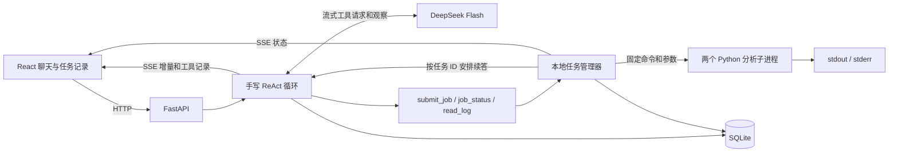

# 科研计算任务助手

在本机用自然语言提交 FASTA 分析，查看任务状态，再根据实际输出和错误日志解释结果。界面保留每次工具的名称、入参与返回值。会话、上传文件和计算结果在关闭页面或重启后端后仍可查阅。

## 启动

项目需要 Python 3.12 和满足 Vite 要求的 Node.js。当前开发环境使用 Python 3.12.14 和 Node.js 24.15.0。使用独立电脑复现时，可安装 Python 3.12 和 Node.js 22.12 或更新的 LTS。以下命令均在仓库根目录执行。

### Windows PowerShell

```powershell
py -3.12 -m venv .venv
.\.venv\Scripts\python.exe -m pip install -r requirements.txt
npm --prefix frontend ci
npm --prefix frontend run build
if (-not (Test-Path .env)) { Copy-Item .env.example .env }
```

已有虚拟环境时可跳过创建步骤。Windows 的 Python 安装若没有 `py` 命令，可以用已安装的 `python -m venv .venv`。也可用 `uv pip install --python .venv/Scripts/python.exe -r requirements.txt` 安装 Python 依赖。

打开项目根目录的 `.env`，在 `DEEPSEEK_API_KEY=` 的等号后填入自己在 DeepSeek 平台创建的 Key。`DEEPSEEK_MODEL` 和 `DEEPSEEK_BASE_URL` 已有默认值。保留 `deepseek-flash` 和 `https://api.deepseek.com` 即可。模型请求通过 HTTP 流式接口发送。[DeepSeek 首次调用与 Key 入口](https://api-docs.deepseek.com/zh-cn/) · [工具调用协议](https://api-docs.deepseek.com/guides/tool_calls/)

```powershell
.\.venv\Scripts\python.exe -m uvicorn backend.app.api:app --host 127.0.0.1 --port 8767 --timeout-graceful-shutdown 3
```

在浏览器打开 [本机工作区](http://127.0.0.1:8767)。修改 `.env` 后重启服务。Key 留空时仍可打开工作区，页面会提示如何配置。在启用 API 后，聊天文本和限长的工具结果会发给 DeepSeek 用来理解请求和生成解释，FASTA 文件由本机脚本读取。

### macOS 或 Linux

```bash
python3.12 -m venv .venv
.venv/bin/python -m pip install -r requirements.txt
npm --prefix frontend ci
npm --prefix frontend run build
test -f .env || cp .env.example .env
```

按同样方式填写 `.env`，再运行 `.venv/bin/python -m uvicorn backend.app.api:app --host 127.0.0.1 --port 8767 --timeout-graceful-shutdown 3`。开发界面时可另开终端执行 `npm --prefix frontend run dev`，在 `http://127.0.0.1:5173` 打开 Vite 页面，API 仍走 8767。

## 演示路径

1. 在新会话发送“帮我统计一下 sample1 里序列的 GC 含量”。提交后右侧出现任务。完成时自动出现状态、日志调用和解释。展开 `read_log` 可以核对 `seq1` 的 **45 nt、48.89%** 和 `seq2` 的 **47 nt、61.70%**。
2. 在原会话继续说“再对 sample3 做一次”。它应沿用序列统计，并主动读新任务的错误日志。第 1 行缺少 `>`，第 2 行含 `X、1、2、3`。助手会提示补上标题标记并核对非法字符后重试。
3. 发送“找出 sample2 中每条序列最长的 ORF”。`gene_A` 的结果为 **6–83，共 78 nt**，`gene_B` 为 **7–21，共 15 nt**。任务运行时可切换会话，完成后原会话收到提示。
4. 使用“上传 FASTA”添加自己的 `.fa`、`.fasta` 或 `.fna`，再发送一条分析请求。每个文件最大 5 MiB。上传成功显示登记名，分析阶段校验内容。刷新页面后可重新打开上次的会话并展开工具记录。

一份 3–5 分钟的录屏脚本和面谈要点在交付计划中。[三天排期与交付计划](docs/04-三天排期与交付计划.md)

## 架构和实现



- `backend/app/model.py` 解析 DeepSeek 流式正文、按索引拼齐工具参数。`backend/app/agent.py` 执行并回填 `tool_call_id` 对应的结果。每阶段最多调用模型 6 轮。DeepSeek 的模型思考模式使用关闭配置，调用工具和消费结果的 ReAct 循环由应用实现。
- `backend/app/jobs.py` 本地最多同时执行两个任务。每个脚本内部延时 4 秒，提交立即返回，单任务上限默认 60 秒。任务的退出码和输出由后端记录。任务结束时，助手查询同一个 ID，再读日志生成解释。
- `backend/app/store.py` 管理 SQLite 中的会话、消息、工具记录、文件登记和任务。相同客户端消息的重发使用同一消息 ID，重复工具提交复用同一任务。重启时无法确认的在途任务标为中断，待解释的终态可从原日志恢复。
- `scripts/` 放两个可单独运行的脚本。统计以 A、C、G、T 为 GC 分母，IUPAC 歧义碱基计入总长度。ORF 取正链三个阅读框中最长的完整 `ATG` 到同框终止区间，坐标从 1 开始、含两端，等长取较早起点。`sample3` 的两处错误由同一个共享解析器收集。
- `frontend/` 通过一个 SSE 连接接收消息增量、工具轨迹和任务通知。断线后从 SQLite 快照恢复。`var/` 保存 SQLite、上传文件和两路原始日志，工具预览每路最多约 8 KiB。任务记录可下载完整日志。模型调用失败时，系统仍能读取本机日志，并提供“重新解释”。

这次交付采用单机、单个后端进程及固定分析工具。已实现的加分项是主动完成通知、上传 FASTA 和关键用例测试。MCP 和 Docker Compose 留作后续选项。对照项目、计算基准和验收条件见评审文档。[技术方案](docs/02-技术调研与开发方案.md) · [样例基准与验收用例](docs/03-样例基准与验收用例.md)

## 测试

```powershell
.\.venv\Scripts\python.exe -X utf8 -m unittest discover -s tests -v
npm --prefix frontend run build
```

测试使用可控的模型流式响应，实际运行本机分析子进程和 SQLite。重点覆盖四条样例结果、坏文件、分片工具参数、异步运行、重复请求、会话恢复、超时和上传。真实模型联调使用上面的演示路径，需要自己的 Key。

## 打包

本地 Git 提交记录保留开发过程。准备评审材料时使用一个独立的 Git 仓库链接，或用 Git bundle 保存全部提交历史。

```powershell
git bundle create research-task-assistant.bundle --all
```

接收方可用 `git clone research-task-assistant.bundle research-task-assistant` 恢复源码和历史。`.env`、`var/` 和 Office 源题均由 `.gitignore` 排除。提交给研究院时，附上使用真实模型录制的 3–5 分钟演示，包含 `sample3` 的失败诊断。
