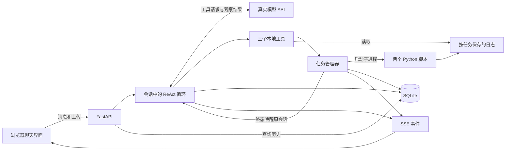

# 科研计算任务助手技术调研与开发方案

建议采用 **React + TypeScript 聊天界面、FastAPI 单进程后端、SQLite 和两个 Python 分析脚本**。模型负责理解请求、选择工具和组织解释。后台任务管理器负责真实的进程、状态和日志。这样，评审者问“这个百分比从哪来”时，可以从聊天回复一直查到计算它的脚本输出。

## 一 参考了哪些项目

| 对象和证据 | 核对到的设计 | 本项目的选择 |
| --- | --- | --- |
| Galaxy 开源科研计算平台，已阅读 `api/jobs.py` 核心源码 | 接口按 `job_id` 读取工具的 stdout 和 stderr，两路都接受读取位置和长度 | 借鉴任务 ID 与双路日志的对应关系，自己写小型本地任务管理器。三个工具已能覆盖本题。[Galaxy 作业接口源码](https://github.com/galaxyproject/galaxy/blob/dev/lib/galaxy/webapps/galaxy/api/jobs.py) |
| Seqera Co-Scientist 和 Seqera Platform，已阅读官方产品文档 | 用户可结合当前运行询问失败原因，运行详情能查看任务状态、退出码和日志 | 借鉴“追问绑定具体任务”的交互。聊天工具卡直接关联本地任务，首版无需接入 Nextflow 或云计算环境。[Co-Scientist](https://docs.seqera.io/platform-cloud/co-scientist) · [运行详情](https://docs.seqera.io/platform-cloud/getting-started/quickstart-demo/view-run-information) |
| Biopython，已阅读 `FastaIO.py` 中的两个解析器 | `SimpleFastaParser` 会跳过第一个合法标题之前的文本，单独使用会漏掉 `sample3` 的坏记录。`FastaTwoLineParser` 的两行限制又会拒绝 `sample2` 的合法换行 | 两个脚本共用一个带行号的严格解析器，保留跨行能力并收集多项错误。三天内实现和解释这段逻辑的成本可控。[Biopython 解析器源码](https://github.com/biopython/biopython/blob/master/Bio/SeqIO/FastaIO.py) |
| DeepSeek Flash，已阅读官方工具调用和 Chat Completions 文档 | 模型返回工具请求，应用执行并以同一 `tool_call_id` 回传。流式参数可能分成多个片段 | 用 HTTPX 读取流式响应，应用实现参数拼接、工具分发和终止条件。使用 `deepseek-flash` 作为默认模型 ID。[工具调用协议](https://api-docs.deepseek.com/guides/tool_calls/) · [Chat Completions](https://api-docs.deepseek.com/api/create-chat-completion/) |

此次已在本机读取题面样例、复算统计值和 ORF 坐标。参考平台以公开源码和官方文档为依据。应用使用可控的模型流式响应联调，DeepSeek 账号的真实工具调用在配置 API Key 后实测。

## 二 系统结构与运行方式



浏览器通过 HTTP 发消息，通过一个 SSE 连接收文字增量、工具卡和任务状态。FastAPI 在本机执行受控工具，只有模型推理使用配置的 API。FASTA 文件由本机脚本读取，模型请求携带对话文本、文件名、任务 ID 和限长的结构化结果或诊断。浏览器的 `EventSource` 可以用命名事件接收服务端推送，并在断线后尝试重连。[HTML 标准中的 SSE](https://html.spec.whatwg.org/multipage/server-sent-events.html)

**建议的项目目录。** 这是后续开发时的模块归属。

```text
backend/app/    api.py        会话、消息、上传、SSE 入口
                model.py      DeepSeek 流式接口与工具参数拼接
                agent.py      工具调用循环、任务完成后的续答
                tools.py      三个工具的参数和返回契约
                jobs.py       后台运行、状态转换、日志读取
                store.py      SQLite 读写和会话历史
scripts/        fasta.py      公用的输入校验和记录解析
                seq_stats.py  逐条统计
                find_orf.py   逐条查找最长 ORF
frontend/src/                 会话侧栏、聊天消息、工具卡、上传入口
data/                         题面三个原始样例，包括原样保留的坏文件
var/                          本机数据库、上传文件、按任务分目录的日志
tests/                        分析规则、任务执行、工具循环与恢复用例
```

开发时由 Vite 代理 `/api` 到后端。交付时可将前端构建产物交给 FastAPI 提供，用同一个本地地址打开界面。后端以单 worker 启动，使运行队列、事件推送和 SQLite 的归属清楚。README 写明实际测过的 Python、Node、依赖版本和启动命令。

## 三 三个工具的契约

会话 ID、用户消息 ID 由后端注入。模型可提供的参数只限下表，各工具均使用实际返回值生成工具卡。

| 工具 | 模型入参 | 返回及行为 |
| --- | --- | --- |
| `submit_job` | `analysis_type` 为 `seq_stats` 或 `find_orf`，`filename` 为已登记文件名 | 校验文件归属和分析类型，持久化任务并入队，返回 `job_id, state, analysis_type, filename`。首次通常为 `queued`，提交请求不等待脚本完成 |
| `job_status` | `job_id` | 返回 `job_id, state, analysis_type, filename` 及已有的提交、开始、结束时间，结束后附 `exit_code` 或运行器错误。正在排队、运行中、成功、失败分别对应 `queued, running, succeeded, failed` |
| `read_log` | `job_id` | 返回 `job_id, state, stdout, stderr, stdout_truncated, stderr_truncated`。建议每路最多返回 8 KiB，过长时保留首尾并标出省略。任务运行中可返回已有内容和当前状态 |

工具错误使用稳定错误码和可读说明。例如找不到文件返回 `FILE_NOT_FOUND`，未知或不属于当前会话的任务返回 `JOB_NOT_FOUND`。提交前的参数错误不会生成一个虚构任务。文件内容错误由已创建的分析子进程产生，因此坏 FASTA 也有可追踪的任务 ID、失败状态和日志。

**幂等边界。** 同一条用户消息的网络重试或同一次模型提交的重放应返回已有任务。建议以原始用户消息 ID、分析类型、解析后的文件标识建立唯一约束。研究员另发“再做一次”会生成新的用户消息 ID，可以再次计算。内置样例允许 `sample1` 这样的无后缀简称，存在多个匹配时列出候选文件请用户选定。

## 四 模型如何调用工具并继续回答

1. **接收消息。** 后端先保存用户消息，再给模型提供近期对话文本、文件名和任务摘要。这一轮的工具请求与返回用原调用 ID 配对。历史中的完整工具记录留在 SQLite，页面刷新后仍可展开。用户说“再做一次”时参考本会话最近明确的分析类型。
2. **处理模型流。** 普通正文增量直接推给页面。按工具索引拼齐分片中的名称、ID 和参数 JSON，收齐后做 Schema 校验。发出 `tool.started`，执行登记工具，保存并推送 `tool.finished`，把带原 `tool_call_id` 的结果作为 tool 消息回传。每一轮处理模型实际请求的全部调用。
3. **交还输入框。** 工具返回任务 ID 即展示回执。模型基于回执简短确认，本轮可结束，任务继续运行。查询到 `queued/running` 时可说明当前进度并等待完成事件。用户的下一条消息可被受理，后台计算期间不反复请求模型查状态。
4. **按任务续答。** 子进程收尾并写入终态后，后台向原会话投递带 `job_id` 的完成事件。续答阶段只开放 `job_status` 和 `read_log`。模型先查对应任务，再读对应日志。后端检查确实取得该 ID 的状态和日志，才发布最终结果或诊断。失败事件与成功事件采用同一条续答路径。
5. **处理提前结束或中断。** 缺少必要工具记录时，先提示模型补齐缺项。建议每阶段最多 6 轮，避免参数错误或重复调用耗尽时间。若模型不可用或仍无法完成解释，后端实际读取该任务日志，工具卡标注为系统读取，保留真实状态和日志，并提供“重新解释”。重新解释复用同一 ID。真实模型正常完成的路径单独验收。

一次会话内串行写入模型轮次，后台任务独立运行。续答绑定原始消息和任务 ID，即使另一条请求先结束，结果仍归回正确任务。页面呈现用户可核对的工具记录、状态和回答。

## 五 本机脚本与任务生命周期

**执行。** `submit_job` 先将 `queued` 写入 SQLite 后返回。后台协程领取任务，记录 `running`，通过 `subprocess.Popen` 用当前 Python 解释器、固定脚本和已登记文件启动子进程，`shell=False`。工作线程等待子进程退出。两个脚本各自在入口延时 4 秒，最多同时运行 2 个任务，单任务默认超时 60 秒。子进程输出分别写入任务目录中的 `stdout.log` 和 `stderr.log`。[Python 子进程文档](https://docs.python.org/3/library/subprocess.html#subprocess.Popen)

**收尾。** 两路日志关闭后，根据退出码写 `succeeded` 或 `failed`，再推送终态和安排续答。正常退出码为 0，建议格式错误用 2，其他运行错误保存实际退出码。启动失败或超时时由运行器另外记录原因。正常终态只转换一次。启动时如果找到上次遗留的 `queued/running` 任务，标记为中断失败并记录“后端重启，未确认上次执行结果”，由用户决定是否重提。已完成任务如仍待解释，则用原 ID 补做一次。以任务 ID 约束自动完成消息唯一，避免重复通知。

**FASTA 校验。** 按行读取 UTF-8 文本，识别 BOM 和常见换行，跳过空白行。标题以 `>` 开头，首个非空字段是 ID，可跟描述。每条记录允许多行序列，保留原始行号。首个非空行缺标题时记录错误，并继续检查下一合法标题前的序列行。空文件、空标题、空记录及非法字符均给出原因。先完成全文件校验，再发布成功输出。对 `sample3`，错误日志应同时含 `MISSING_HEADER`（第 1 行）与 `INVALID_BASE`（第 2 行，`X、1、2、3`）。遇到不确定碱基时按验收文档定义处理。[NCBI FASTA 格式](https://www.ncbi.nlm.nih.gov/genbank/fastaformat/)

**计算与输出。** `seq_stats` 对每条记录计数。`find_orf` 依次扫描正链的三个阅读框，每框保留当前区段最早的起始位置，遇到同框终止密码子即比较候选并重置。同一终点的内层起始只能形成更短的候选。三个阅读框合计线性扫描。建议 stdout 每行一条 JSON 记录，最后一行记总条数。stderr 给出含行号、错误码和简短说明的诊断。页面把结果按行展示，模型根据已读数据解释。遇到截断时，回答注明实际展示的范围，完整文件仍留在本机任务目录。[计算口径与样例](03-样例基准与验收用例.md)

**脚本输出契约。** 下表是后续实现应产生的单行 JSON 示例。含百分比的数值在界面统一显示两位小数。

| 来源 | 一条记录的示例 |
| --- | --- |
| `seq_stats` 标准输出 | `{"id":"seq2","length_nt":47,"gc_pct":61.7}` |
| `find_orf` 标准输出 | `{"id":"gene_A","orf":{"start":6,"end":83,"length_nt":78}}` |
| 任一脚本成功时的末行摘要 | `{"record_count":2}` |
| 输入校验错误的标准错误输出 | `{"code":"INVALID_BASE","line":2,"characters":["X","1","2","3"],"message":"序列含无法识别的字符"}` |

## 六 数据保存和前端接口

| SQLite 表 | 主要数据 | 用途 |
| --- | --- | --- |
| `conversations` | `id, title, created_at, updated_at` | 左侧列表与会话切换 |
| `messages` | `id, conversation_id, turn_id, role, content, tool_calls_json, tool_call_id, job_id, kind, status`。用户消息另有 `client_message_id` | 保存用户与助手文本、工具请求及返回，按真实顺序还原工具卡。记录生成中、完成或中断状态 |
| `jobs` | `id, conversation_id, origin_message_id, file_id, analysis_type, state, exit_code, runner_error, log_dir, summary_state` 及时间 | 查状态、定位双路日志、恢复任务解释，区分计算失败和解释服务异常 |
| `files` | `id, conversation_id, display_name, storage_name, source, size_bytes` | 内置样例全局只读，上传文件归本会话。以内部标识存盘，工具仍按文件名使用 |

用户消息入库后才确认接收，助手文本按增量保存。工具调用和返回写入后再通知前端。正常重启后，未完成回复标为中断并保留已有文本。SQLite 更新在后端事件循环中通过短事务完成。

| 浏览器接口 | 作用 |
| --- | --- |
| `POST /api/conversations`、`GET /api/conversations` | 新建会话，列出历史、最近时间和任务提示 |
| `GET /api/conversations/{id}` | 取得消息、工具轨迹和任务快照，供切换与重连使用 |
| `POST /api/conversations/{id}/messages` | 接受 `client_message_id, text`，先落库，再回 HTTP 202 和消息标识 |
| `GET /api/events` | 单机单用户的 SSE。推送 `message.delta`、`message.done`、`tool.started`、`tool.finished`、`job.updated`，携带会话及对应消息、调用或任务的 ID |
| `POST /api/conversations/{id}/files?filename=…` | 接收一个文件的字节流，返回当前会话可引用的文件名和内部文件标识 |
| `GET /api/conversations/{id}/jobs/{job_id}/logs/{stream}` | 下载任务原始输出或错误日志 |
| `POST /api/conversations/{id}/jobs/{job_id}/retry-summary` | 复用现有日志重新生成解释 |

**聊天界面。** 左侧放历史会话和新建按钮，中间放消息及可折叠工具卡，输入区放发送与上传。逐步显示真实模型增量。收齐一条消息后，用持久化的最终正文校准显示。浏览器重连时先订阅并暂存新事件，再载入列表及会话快照，按 ID 和消息偏移合并。离开当前会话后收到的完成事件更新原会话提示，重新进入即可核对结果。

**文件与配置。** 每文件最大 5 MiB，接受 `.fa`、`.fasta`、`.fna`。同会话重名或与内置样例重名时提示改名，文件内容交给分析脚本检验。工具只访问登记文件和任务日志，前端展示可读文件名。后端读取 `DEEPSEEK_API_KEY`、`DEEPSEEK_BASE_URL` 和 `DEEPSEEK_MODEL`。`.env.example` 保留默认模型和端点，Key 留空。源码包排除实际 `.env` 与 `var/`。

[需求与业务流程](01-需求分析与业务流程.md) · [样例基准与验收用例](03-样例基准与验收用例.md) · [三天排期与交付计划](04-三天排期与交付计划.md)
